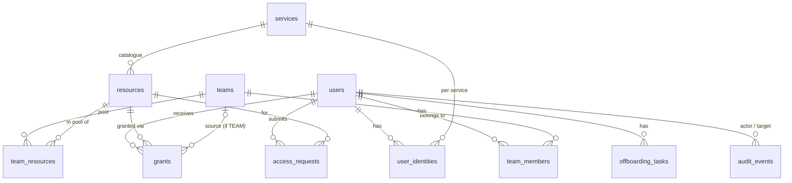

# Cerberus Refactor — Design

Status: draft, planning phase. Branch: `pratyush/refactor`. Last updated: 2026-10-14.

Items marked **[OPEN]** are not decided. Items marked **[UNVERIFIED]** are assumptions
that need a test before we rely on them.

---

## 1. Goal

The professor has many students working under him. Students need access to a mix of external
services, with different students needing different ones. Today he grants and revokes that
access by hand.

Cerberus should let him, from one place:

- onboard and offboard students;
- grant and revoke their access to external services;
- see who has access to what, and why.

In scope: all nine existing integrations (Google Drive, Discord, Google Cloud, BigQuery,
Firebase, Google Analytics, Google Play Console, App Store Connect, Kanboard).

### Industry reference

This is the **joiner–mover–leaver (JML)** part of what the industry calls *identity governance
and administration*. Off-the-shelf tools exist (Okta Workflows, ConductorOne, Lumos, the
open-source midPoint). They are oversized for one lab, and as far as we know none ships
connectors for all nine of our services, so we build. We borrow their proven patterns:

| Pattern | What it means here |
|---|---|
| Connector interface | Every service implements the same small contract. The core never contains service-specific code. |
| Desired-state grants | The DB records who *should* have access. Calls to the external API carry out that record; they are not the record itself. |
| Bundles | Teams carry a pool of resources; membership decides what a student can be given. |
| Append-only audit | Every change records who did it, to whom, when, and the outcome. |

---

## 2. Current state: gaps that drive this refactor

Each point is from reading the code on `pratyush/refactor` as of 2026-10-09.

| # | Gap | Where |
|---|---|---|
| G1 | One row means two things: `user_service_access.external_account_identifier` holds the *resource* (e.g. Drive folder ID) and the same row is the *grant*. There is no catalogue of resources. | all integration controllers |
| G2 | Drive picks a folder by borrowing another user's row (`LIMIT 1`), falling back to a hard-coded folder ID. The admin can't see or choose what is granted. | `backend/src/controllers/googleDrive.controller.js:87-95` |
| G3 | Nine controllers (278–698 lines each) each repeat their own SQL, logging, error handling and API calls. There is no shared connector layer. | `backend/src/controllers/*.controller.js` |
| G4 | The audit log is weak. `log.performed_by` is a free-text name (not a user FK). The column is added by an `ALTER TABLE` that runs on every log write. Failed log writes are swallowed with `console.error`. 86 call sites each build their own log entry. | `backend/src/utils/logUtils.js:20-31` |
| G5 | There are four roles (ADMIN/MANAGER/OPERATOR/MEMBER). The middle two don't match how the lab works. | `backend/src/config/roles.config.js` |
| G6 | A GET handler writes to the database: `getRoleUsers` runs two `UPDATE`s. | `backend/src/controllers/roles.controller.js:224-229` |
| G7 | There is no migration tooling. SQL is applied by hand. | `backend/sql/` |
| G8 | Onboarding a Drive user is logged as an offboarding. | `to-do/google drive.txt` |
| G9 | The frontend production build fails: `sidebar.js` uses Tailwind v4 syntax on Tailwind v3. | `frontend/src/components/ui/sidebar.js:132,135` |
| G10 | There are no teams, no access requests, no student-facing views, and no forgot/reset password. | — |
| G11 | Schema name is hard-coded. `DB_SCHEMA` sets `search_path`, but queries also say `easleydunn.<table>` explicitly, so changing the env var doesn't move them to another schema. (Some `easleydunn.` matches are the `easleydunn.com` email domain and are fine.) | `roles.controller.js` (13), `passwordAuth.controller.js` (4), `users.controller.js` (3), `roles.routes.js`, `auth.routes.js`, `requireAuth.middleware.js:43` |
| G12 | The same SQL is copied across files: `SELECT … FROM users WHERE user_id = $1` 14 times, `SELECT … FROM services WHERE service_code = …` about 23 times. There is no data-access layer; controllers call `getPool().query` directly. | `backend/src/controllers/*.controller.js` |

---

## 3. Roles and permissions

### 3.1 Roles

| Role | Kind | Who |
|---|---|---|
| ADMIN | global | The professor. The only admin. |
| USER | global | Students. Can log in. |
| LEAD | global | Team leads. Can log in. Lead permissions apply **only to the one team they lead**. |

Decided 2026-10-21 (replaces the 2026-10-09 "lead = per-team flag only"):
- A LEAD leads **exactly one** team and is a member of it (`team_members.is_lead = true`). The
  role says *that* they are a lead; the membership flag says *which* team.
- Anyone, a LEAD included, can be a plain member of other teams. There, a LEAD has no lead
  permissions.
- A team can have **several leads, or none**.
- If a LEAD stops leading their team, the role stays LEAD until the admin changes it manually.
- **[ASSUMPTION]** If the admin demotes a LEAD to USER, their `is_lead` is set to false in the
  same transaction (the alternative is to block the demotion until the flag is cleared).

MANAGER and OPERATOR are removed.

Considered and **not adopted** (2026-10-09): a temporary / delegate role with custom privileges
chosen by the professor. The role set stays ADMIN / LEAD / USER for now.

### 3.2 Permission matrix

| Action | ADMIN | LEAD (of team T) | USER |
|---|---|---|---|
| Create / archive users | ✅ | ❌ | ❌ |
| Create / rename / archive teams | ✅ | ❌ | ❌ |
| Add / remove team members, set lead | ✅ | ❌ | ❌ |
| Manage the resource catalogue | ✅ | ❌ | ❌ |
| Attach resources to a team's pool | ✅ | ❌ | ❌ |
| Grant / revoke any resource to anyone | ✅ | ❌ | ❌ |
| Grant / revoke a resource from T's pool to a member of T | ✅ | ✅ | ❌ |
| View T's members and their access | ✅ | ✅ | ❌ |
| Decide access requests | ✅ | ❌ | ❌ |
| View own access | ✅ | ✅ | ✅ |
| Submit an access request | — | ✅ | ✅ |
| Enter / edit own external identifiers | — | ✅ | ✅ |
| Edit anyone's external identifiers | ✅ | ❌ | ❌ |
| View own offboarding checklist | — | ✅ | ✅ |

### 3.3 Enforcement

Lead permissions are checked **on the server for every request**. For any lead action, all
four conditions must hold:

1. the caller has role LEAD **and** their membership of team T has `is_lead = true`;
2. the target user is a member of T;
3. the resource is in T's pool (`team_resources`);
4. the access level being granted is at or below the pool's ceiling (`team_resources.max_role_name`).

The frontend hiding a button is not a control. This check is the main protection against
IDOR / privilege escalation in the new design.

---

## 4. Data model



### 4.1 Tables

**`users`** (existing, changed)
- `"Role"` → values `ADMIN | LEAD | USER` (existing MEMBER rows map to USER; MANAGER/OPERATOR to be decided case by case).
- Add `status`: `active → offboarding → inactive` (replaces the overloaded `is_active`).
  `inactive` is the final state: no access, can't log in, record kept. A returning student goes
  `inactive → active` (a new joiner event).
- `start_date` (date) **already exists** in `easleydunn.users` (set to `CURRENT_DATE` on create). Keep it; informational only.
- Add `hash_version` for the password pepper/HMAC fix (§8).
- Add `end_date` (date, nullable): expected end of the student's time in the lab. **Informational only.**
  It never triggers offboarding (§6.7).
- Add `end_date_set_by` (FK users). Only the admin can set or change `start_date` / `end_date`.

**`teams`** (new)
| column | type | notes |
|---|---|---|
| team_id | serial PK | |
| name | text NOT NULL | unique case-insensitive among active teams |
| description | text | |
| is_active | boolean default true | archive, never hard-delete |
| created_by | int FK users | |
| created_at / updated_at | timestamptz | |

**`team_members`** (new)
| column | type | notes |
|---|---|---|
| team_id | int FK teams | |
| user_id | int FK users | |
| is_lead | boolean default false | which team a LEAD leads; true only if the user's role is LEAD (checked in the service, a CHECK can't read `users`) |
| added_by | int FK users | |
| added_at | timestamptz | |
| | PK (team_id, user_id) | index on user_id |
| | partial unique index `(user_id) WHERE is_lead` | a user leads at most one team; a team can have several leads or none |

**`services`** (existing) adds a `connector_key` that maps the row to its connector module.

**`resources`** (new): the per-service catalogue. Examples: a Drive folder, a Discord role, a
GCP project, a Kanboard project.
| column | notes |
|---|---|
| resource_id | PK |
| service_id | FK services |
| external_id | folder ID / role ID / project ID |
| name | human label |
| default_role_name | default access level for direct grants / requests, e.g. Drive `reader`, GCP `roles/viewer` |
| is_active | removing a resource from the catalogue revokes it from everyone |
| created_by | FK users |

> **[OPEN] Detail level.** Should the professor grant "Discord" as a whole or "this Discord
> role"? The model supports both: "whole service" is a single default resource for that
> service. So this decision doesn't block the schema.

**Access levels** (decided 2026-10-21): the level lives on each grant, not on the user's role.
User A can have Drive folder B as `reader` and Drive folder C as `writer`. Each connector
declares its allowed levels, ordered low → high (Drive: `reader < commenter < writer`), and every
`role_name` / `max_role_name` is validated against that list.

> **[OPEN] Non-linear levels.** Some services aren't a hierarchy (GCP IAM roles). For those, a
> "ceiling" doesn't work; the pool would store a list of allowed levels instead of a maximum.

**`team_resources`** (new): the team's pool. `(team_id, resource_id)` PK, `max_role_name` (the
highest level a lead can grant from this pool entry), `added_by`, `added_at`.

**`user_identities`** (new): replaces `user_service_access.external_user_identifier`.
| column | notes |
|---|---|
| user_id, service_id | PK pair |
| external_identifier | Discord username, Apple ID email, etc. |
| entered_by | the student or the admin |
| verified_by / verified_at | admin verification; **grants are blocked until this is set** (§9) |

**`grants`** (new): desired state. Replaces `user_service_access`.
| column | notes |
|---|---|
| grant_id | PK |
| user_id, resource_id | |
| role_name | NOT NULL; access level, e.g. Drive `reader` / `commenter` / `writer` |
| source | `DIRECT` (admin) or `TEAM` |
| team_id | set when source = TEAM |
| granted_by | FK users |
| status | `pending → active` or `failed`; `revoking → revoked` |
| external_ref | ID returned by the service (permission ID, invite ID…) |
| created_at, revoked_at, revoked_by | |

The same resource can be granted to the same user through more than one source (two teams,
or a team and a direct grant). The external access is revoked only when **no active grant
row** for that user and resource remains.

**`access_requests`** (new): `user_id`, `resource_id`, `requested_role_name`, `reason`,
`status (pending|approved|denied)`, `decided_by` (always the admin), `decided_at`. Approval
creates a `DIRECT` grant; the admin approves the requested level as-is or changes it, and the
grant's `role_name` stores the final level.

**`offboarding_tasks`** (new): `user_id`, `service_id`, `kind` (e.g.
`DRIVE_OWNERSHIP_TRANSFER`), `status`, `detail jsonb`.

**`audit_events`** (new): replaces `log`.
| column | notes |
|---|---|
| event_id | PK |
| actor_user_id | FK users; null only for system jobs |
| action | e.g. `TEAM_CREATED`, `MEMBER_ADDED`, `GRANT_CREATED`, `GRANT_REVOKED` |
| target_user_id, team_id, resource_id, grant_id | whichever apply |
| outcome | `SUCCESS | FAILED` |
| detail | jsonb |
| created_at | |

The app's DB role gets INSERT and SELECT only (no UPDATE or DELETE), so rows can't be altered
after they're written. Audit writes happen in the same transaction as the change they record.
They are not fire-and-forget.

**`session`** (existing) is unchanged.

---

## 5. Connector contract

Each service is a module in `backend/src/connectors/<key>.connector.js`:

```js
module.exports = {
  key: "GOOGLE_DRIVE",
  // Is this identifier well-formed / does the account exist?
  async validateIdentity(identifier) {},
  // Give `identity` access to `resource` with `roleName`. Must be idempotent.
  async grant({ identity, resource, roleName }) { /* returns { externalRef } */ },
  // Remove that access. Must be idempotent (already gone = success).
  async revoke({ identity, resource, externalRef }) {},
  // Optional: who currently has access to the resource (for future drift detection).
  async listAccess(resource) {},
  // Optional: tasks a leaving user must complete (e.g. Drive ownership transfer).
  async offboardingChecks(identity) {},
};
```

The **core grant service** (`backend/src/services/grants.service.js`) owns everything else:

1. permission check (§3.3);
2. write the `grants` row as `pending` and an audit event, in one transaction;
3. call `connector.grant(...)`;
4. set the row to `active` (storing `externalRef`) or `failed`, with an audit event.

Connectors only talk to the external API. They never touch the DB or the log. This removes G3,
G4 and G8 by construction.

A **manual connector** covers any service without a usable API. `grant`/`revoke` create a task
for the admin ("add X to Y by hand"), and the grant becomes `active` when the admin marks the
task done.

Existing API-call code in the nine controllers gets moved behind this contract, not rewritten
from scratch.

### 5.1 Backend layers

Decided 2026-10-14: keep the current by-layer folders, and add a **repository layer** for all
SQL (fixes G12).

| Layer | Folder | Does | Never |
|---|---|---|---|
| Middleware | `middlewares/` | Generic "may this request continue?" checks: auth, role, password-current | Business rules that depend on data (e.g. "lead of *this* team") |
| Controller | `controllers/` | HTTP in, HTTP out: read params/body, call a service, send the response | SQL, external API calls |
| Service | `services/` | Business rules, permission checks (§3.3), transactions | Read `req`/`res` |
| Repository | `repositories/` (new) | SQL only. One function per query, e.g. `findById`, `findByCode` | Business rules, HTTP, external APIs |
| Connector | `connectors/` | External API calls only (§5) | DB, audit log |

Rules:
- Only repositories run SQL. Controllers and services don't import `getPool`.
- A query used in more than one place exists once, in its repository.
- The repository layer removes duplicate code. It doesn't reduce how many queries a request
  makes; that's a separate optimisation.

Granularity, decided 2026-10-14: **one file per table**, named in camelCase like the rest of
`src/` (`users.repo.js`, `services.repo.js`, `teams.repo.js`, `teamMembers.repo.js`, …). A
single file would grow past 1,000 lines once teams, grants, audit and resources exist.

**[OPEN]** Transactions: there is no `@Transactional`. Proposed: every repository function takes
the DB handle as its first argument (`findById(db, id)`, where `db` is the pool or a transaction
client), and a `withTransaction(fn)` helper in `db/` gives a service one client for
`BEGIN`/`COMMIT`/`ROLLBACK`. Needed for the role-demotion flag clear (§3.1) and the grant flow (§5 step 2).
Decide before 1a, because it fixes every repository function's signature.

**[OPEN]** When existing queries move: proposed, new code uses repositories from 1a on, and
each old controller's SQL moves when that feature is ported (1b–2), not all at once up front.

---

## 6. Workflows

### 6.1 Onboard a student
1. Admin creates the user (`status = active`, role USER).
2. Email goes out with a temporary password (`backend/src/utils/mail.js`).
3. On first login the student must change the password (existing `requirePasswordCurrent`).
4. The student enters their external identifiers. Admin verifies them.
5. Admin adds the student to one or more teams.

### 6.2 Grant from a team pool
Lead (or admin) picks a team member, a resource from the team's pool, and an access level up to
the pool's `max_role_name`. The core grant service runs §5 steps 1–4.

### 6.3 Access request
1. Student requests a resource and an access level, with a reason.
2. Admin approves (keeping or changing the level) or denies.
3. If approved, a `DIRECT` grant is created.
4. The student is emailed either way.

### 6.4 Remove a member from a team
Every `TEAM` grant with that `team_id` for that user is revoked. For each one, the external
access is removed only if no other active grant covers the same resource (§4.1 `grants`).

### 6.5 Remove a resource from the catalogue / a team's pool
- Removed from the catalogue: every grant of it is revoked.
- Removed from a team's pool: every `TEAM` grant of it from that team is revoked, using the
  same rule as 6.4.

### 6.6 Offboard a student
1. `status → offboarding`.
2. Revoke every active grant.
3. Generate `offboarding_tasks` from each connector's `offboardingChecks`.
4. The student sees the checklist. Admin can see it too and override it.
5. When all tasks are done (or overridden by the admin): `status → inactive`, remove team
   memberships, and revoke all sessions (`session.service.revokeAllForUser`).

### 6.7 End date approaching
1. The admin sets `users.end_date` on the profile (at onboarding or later).
2. When the date is near, the student sees a prompt in the portal to ask the professor for an
   extension.
3. The extension request goes to the professor, who either moves `end_date` or leaves it.
4. Nothing is revoked or offboarded automatically. Offboarding stays a deliberate admin action
   (§6.6).

- The end date comes from the student's offer letter; the professor enters it.
- The prompt appears **"2" before the end date for now. The unit (weeks or months) is
  unconfirmed.** Exact details decided later.
- The professor sees "ending soon" and "past end date" students as a **list on the admin
  dashboard**. No email.
- **[OPEN]** Is an extension request its own type, or an `access_requests` row with a
  different kind?
- **[OPEN]** What does the student see after the date passes with no extension? (The
  professor's side is covered by the dashboard list.)

---

## 7. Google Drive ownership on personal Gmail

Users are on personal Gmail, with no Google Workspace. That means:

- There are no shared drives. A file a student creates inside the professor's folder is still
  **owned by the student**.
- Revoking the student's access to the folder does not remove their ownership of their own
  files in it.

**[UNVERIFIED]** For consumer accounts, ownership transfer works through a *pending owner*
request that the student must accept. The admin can't force it. If that's true, Drive's
`offboardingChecks` should:

1. list files in catalogued folders owned by the student (the current controller already has an
   `/audit` endpoint for owned files);
2. send pending-owner requests to the professor;
3. block offboarding completion until each file is transferred, or the professor chooses
   "copy and accept loss".

**Proposed test:** use the test folder from `to-do/to-do.txt` with two personal accounts.
Create a file as account B and attempt a pending-owner transfer to account A. Record what the
API allows and what B sees.

---

## 8. Features

### Now
- Teams + membership (step 1, see §10)
- Resource catalogue + team pools
- Core grant service + connector contract
- Audit log with actor (`audit_events`)
- Student portal: own access, access requests, offboarding checklist, own identifiers
- End date on the profile, with an extension prompt as it approaches (§6.7). Informational, never auto-offboards.
- Email notifications: account created, access granted or revoked, request decided
- Password self-service: forgot password (login page) and admin reset for another user
- Pepper fix: HMAC-SHA256 the password with a real pepper (from env) before bcrypt. This also
  fixes bcrypt's 72-byte truncation. Add `hash_version` and force a reset for existing users
  (from `to-do/October 8th.txt`).

### Later
- Sign in with Google (OAuth). For now we keep the current password flow.
- Drift detection: compare `grants` with each connector's `listAccess` and report mismatches.
- More features to be added.

---

## 9. Security notes

- **Identifiers entered by students are untrusted.** A student could enter someone else's
  Discord username or email and have access granted to that account. Grants are blocked until
  the admin has verified the identity (`user_identities.verified_at`). Connectors should also
  match exactly (e.g. the existing exact Discord username match).
- **Lead scope** is checked on the server (§3.3). It is the main new privilege boundary.
- **Audit** is insert-only and transactional (§4.1).
- **Carried over from `to-do/October 8th.txt`**, still open:
  - RLS on `easleydunn.session`, and whether the `easleydunn` schema is exposed through
    Supabase's REST API
  - `sslmode=require` on `DATABASE_URL`
  - a CSRF token if the frontend and API end up on different sites
  - a login rate limiter / account lockout

---

## 10. Build order

Vertical slice first: get one path working end to end, then repeat the pattern.

| Phase | Content |
|---|---|
| 0 | **DB foundation** (§10.0): new `cerberus` schema, `cerberus_test` schema, node-pg-migrate, baseline migration, remove hard-coded schema names (G11). Also fix the frontend build (G9). |
| 1a | **Teams + members** (detailed below). |
| 1b | Role change (ADMIN/LEAD/USER, remove MANAGER/OPERATOR), `audit_events`, `user_identities`. |
| 1c | `resources` + `team_resources`, core grant service, **Drive connector**. Admin, lead and student UI for Drive. |
| 2 | Port the other eight integrations onto the connector contract. Retire `user_service_access` and `log`. |
| 3 | Access requests, end-date prompt + extension request, offboarding workflow + checklist, email notifications, password self-service. |

### 10.0 Phase 0: DB foundation

The refactor gets its own schema. The old `easleydunn` schema is **not altered**; it keeps
serving the current app until cutover.

| Schema | Purpose |
|---|---|
| `easleydunn` | Current app. Untouched. |
| `cerberus` | Refactor branch. |
| `cerberus_test` | Integration tests only. Never holds real data. |

The app chooses the schema with the existing `DB_SCHEMA` env var
(`backend/src/config/db.config.js` → `search_path` in `backend/src/db/database.js`).

**A. Migration tool: node-pg-migrate**
- backend devDependency; migrations in `backend/migrations/`.
- `npm run migrate` targets `cerberus`, `npm run migrate:test` targets `cerberus_test`, and
  `migrate:down` rolls back one step.
- Migrations use unqualified table names, so one set of migrations builds either schema.
- **[UNVERIFIED]** Supabase SSL may need `--reject-unauthorized false` (the app already uses
  `rejectUnauthorized: false`). Try against `cerberus_test` first.
- Running migrations changes the live Supabase project, so Pratyush runs them or explicitly
  says to.

**B. Baseline migration.** This is the standard approach when adding a migration tool to an
existing database.
- `0001_baseline` recreates the current tables as they are: `users`, `services`,
  `user_service_access`, `log`, `session` (with the `sql/001` indexes), and
  `cerberus_admin_tokens` if it still exists. That way the branch app keeps working on
  `cerberus` while features are ported one by one.
- The DDL is read from the live DB **read-only** (no `pg_dump`/`psql` locally; use Supabase
  `information_schema` queries).
- `0002_seed_services` adds the `services` reference rows, copied from `easleydunn.services`.
- **[OPEN]** Copy users/access data from `easleydunn` into `cerberus`? The copy doesn't change
  the old schema. Without it nobody, including the admin, can log in on the branch. Proposed: a
  one-off script `backend/scripts/copy-from-easleydunn.js`, run only on explicit go.

**C. Remove hard-coded schema names (G11).** Replace `easleydunn.<table>` with unqualified
names. Leave the email-domain matches alone.

**D. Test schema wiring**
- `backend/tests/setupEnv.js` (jest `setupFiles`) sets `DB_SCHEMA=cerberus_test` before the
  app loads. It **refuses to run if the schema doesn't end in `_test`**.
- Five existing tests query the DB (`services`, `bigQuery`, `appleStoreConnect`, `googlePlay`,
  `discord`). Run them against `cerberus_test` and note which ones depend on live data.

### 10.1 Step 1a: teams and members

**DB:** migration `0003_teams`. Tables `teams` and `team_members` as in §4.1, including the
"a user leads at most one team" partial unique index.

**Backend:** route → controller → service → repository (§5.1). SQL lives only in
repositories.
- `backend/src/routes/teams.routes.js`, mounted behind `requireAuth, requirePasswordCurrent, requireRole("ADMIN")`
- `backend/src/controllers/teams.controller.js`
- `backend/src/services/teams.service.js`
- `backend/src/repositories/teams.repo.js`
- `backend/src/repositories/teamMembers.repo.js`

| Method | Path | Does |
|---|---|---|
| GET | `/teams` | List active teams with member count and leads |
| POST | `/teams` | Create a team |
| GET | `/teams/:teamId` | Team detail plus members |
| PATCH | `/teams/:teamId` | Rename / change description |
| POST | `/teams/:teamId/archive` | Archive |
| POST | `/teams/:teamId/members` | Add a member `{ userId, isLead }` |
| PATCH | `/teams/:teamId/members/:userId` | Set / unset lead |
| DELETE | `/teams/:teamId/members/:userId` | Remove a member |

Rules:
- Only active, non-admin users can be members.
- Archived teams can't be changed.
- Duplicate active team names are rejected.
- Adding an existing member returns a clear 4xx, not a 500.
- A team can have several leads. Setting a lead fails with a clear 4xx if that user already
  leads another team.
- Removing a lead from the team deletes the membership row, so the flag goes with it.
  `GET /teams` reports teams without a lead.

**Frontend:** a third "Teams" tab beside "access" and "roles" (`frontend/src/App.js:23`), in a
new `TeamsTab.js` component rather than growing `App.js`. It shows the team list with a create
form; clicking a team shows its members, an add-member picker (from `/users`), a lead toggle
and a remove button. Teams without a lead show a "No lead — pick one" badge.

**Tests:** `backend/tests/integration/teams.test.js` against `cerberus_test`, cleaning up its
own rows.

**Not in 1a:** the role rename, lead/student views, resource pools, `audit_events`
(`created_by`/`added_by` record who did what for now).

**Decided for 1a:** several leads per team allowed, a user leads at most one team (2026-10-21);
tests run in `cerberus_test`.

**Open for 1a:**
- **[OPEN]** The LEAD role arrives in 1b, but `is_lead` requires role LEAD. Proposed: in 1a any
  active non-admin member can be flagged, and 1b adds the role check (and converts flagged users
  to LEAD). Alternative: move the role rename into 1a.
- **[OPEN]** Backend and UI together, or backend first and reviewed before the UI?

---

## 11. Open questions (global)

| # | Question |
|---|---|
| Q1 | ~~Migration tool~~. **Decided: node-pg-migrate** (fits the current `pg` + `DATABASE_URL` setup, no CLI/Docker, up/down). |
| Q2 | Is the data in `easleydunn` real? Should it be copied into `cerberus` (§10.0 B)? |
| Q3 | Access detail level: whole service vs per resource, per integration. |
| Q4 | Drive ownership-transfer behaviour on personal Gmail (§7 test). |
| Q5 | Existing MANAGER/OPERATOR users: what do they become? |
| Q6 | End-date details: unit of the "2" lead time, extension request type, what the student sees after the date (§6.7). |
| Q7 | Further features. |
| Q8 | Repository layer details (§5.1): ~~one file per table vs single file~~ **decided: one file per table**; `db`-first-argument + `withTransaction` for transactions; when existing queries move. |
